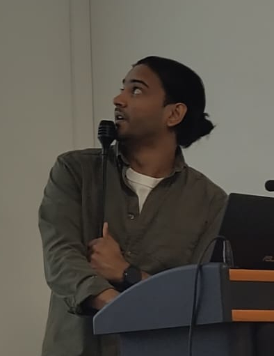
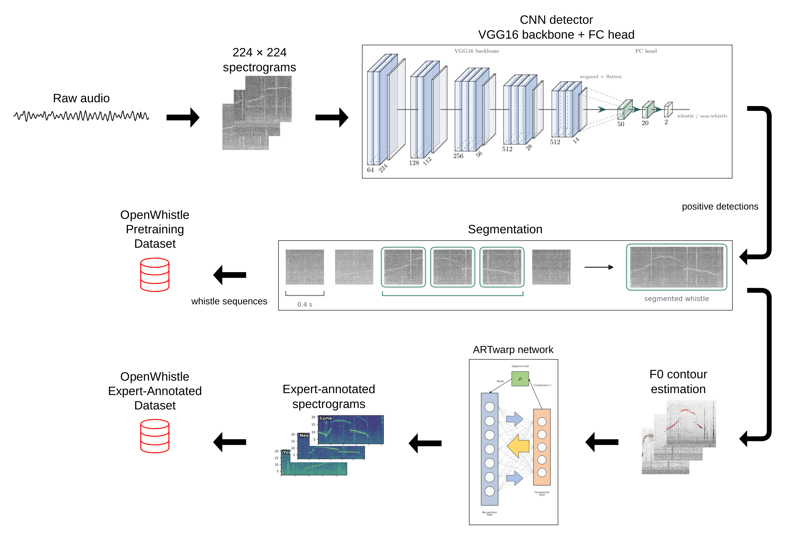

::: {.home-hero}

::: {.profile-card .profile-panel}

<h1 class="profile-name">Faadil Mustun</h1>

Postdoctoral Researcher · ENS Paris

<a class="open-badge" href="#open-to-opportunities">Open to postdoc opportunities</a>

<nav class="contact-links" aria-label="Contact links">
<a href="mailto:faadilmustun@hotmail.fr" aria-label="Email"><i class="bi bi-envelope-fill"></i>Email</a>
<a href="https://scholar.google.com/citations?user=yCws0CEAAAAJ&hl=en" aria-label="Google Scholar"><i class="bi bi-mortarboard-fill"></i>Scholar</a>
<a href="https://github.com/fmustun" aria-label="GitHub"><i class="bi bi-github"></i>GitHub</a>
<a href="https://www.linkedin.com/in/faadil-mustun/" aria-label="LinkedIn"><i class="bi bi-linkedin"></i>LinkedIn</a>
<!-- Once the updated CV is in files/, uncomment the next line:
<a href="files/CV_Faadil_Mustun.pdf" aria-label="Curriculum vitae (PDF)"><i class="bi bi-file-earmark-person-fill"></i>CV</a>
-->
</nav>

:::

::: {.about-panel}

## About

I am a postdoctoral researcher at the Institut de Biologie de l'École Normale Supérieure (IBENS), where I also completed my PhD (Université Paris Cité, 2026). I hold a Bachelor's degree in Mathematics from Université Pierre et Marie Curie and a Master's degree in Applied Mathematics (Statistics) from Sorbonne Université.

My research lies at the intersection of **bioacoustics, animal communication,** and **machine learning**. Using large-scale longitudinal acoustic datasets and self-supervised learning approaches, I investigate how dolphin vocalizations encode information about identity, social relationships, and interaction dynamics.

More broadly, I am interested in developing computational tools to uncover the principles underlying animal communication systems and their evolution. More recently, I have been contributing to the development of multimodal datasets combining acoustic recordings with behavioral annotations extracted from video data.

<strong>🔎 I am looking for my next position.</strong> I am seeking postdoctoral opportunities in computational bioacoustics, animal communication and machine learning for animal behavior, ideally starting around <strong>May 2027</strong> (flexible: earlier or later start dates are possible). If you think my profile could fit your group, I would be happy to hear from you: <a href="mailto:faadilmustun@hotmail.fr">get in touch</a>.

:::

:::

## News

<section class="news-list">

<article class="news-card featured">
  
01 Oct 2026

  <h3>🎓PhD successfully defended</h3>
  
Successfully defended my PhD, <em>From Whistles to Communication: Toward a Computational Understanding of Dolphin Acoustic Signals</em>, in front of a jury composed of Olivier Adam, Hervé Glotin, Laela Sayigh and Marcelo Rozenberg.

</article>

<article class="news-card featured">
  
25 Sep 2026

  <h3>🌟OpenWhistle accepted as a NeurIPS spotlight</h3>
  
Our paper <a href="#openwhistle">OpenWhistle</a> was accepted as a spotlight paper at NeurIPS 2026 (top 1.3% of submissions).

</article>

<article class="news-card">
  
24 Mar 2026

  <h3>🎤Seminar presentation at IBENS</h3>
  
Presented my work at the Neurosection Department Seminar, Institut de Biologie, ENS Paris.

</article>

<article class="news-card featured">
  
03 Feb 2026

  <h3>🐬Dolphin Spotting is live</h3>
  
Launched the citizen science project <a href="https://www.zooniverse.org/projects/sumbredolphin/dolphin-spotting">Dolphin Spotting</a> on Zooniverse to collect behavioral annotations from dolphin video recordings.

</article>

<article class="news-card featured">
  
12 Dec 2025

  <h3>📄Dolph2Vec accepted at NeurIPS workshop</h3>
  
Our paper <a href="#dolph2vec">Dolph2Vec</a> was accepted at the <a href="https://aiforanimalcomms.org">AI for Non-Human Animal Communication workshop</a> at NeurIPS 2025.

</article>

</section>

Show more newsShow less

<section class="news-list">

<article class="news-card featured">
  
Oct 2025

  <h3>🏆PSL-Neuro PhD extension funding</h3>
  
Awarded a 9-month <a href="https://www.psl-neuro.psl.eu/en/calls">PSL-Neuro</a> PhD extension grant (Université PSL) to complete my thesis work.

</article>

<article class="news-card">
  
14 Oct 2024

  <h3>🔬Sharing dolphin communication research with the public</h3>
  
Presented our research on dolphin communication to the general public at the Fête de la Science in Paris.

</article>

<article class="news-card">
  
21 Mar 2023

  <h3>📚Guest lecture on dolphin communication</h3>
  
Gave a guest lecture on dolphin acoustic communication at Ben-Gurion University, Eilat Campus.

</article>

<article class="news-card featured">
  
Oct 2022

  <h3>🏆FIRE doctoral fellowship</h3>
  
Started my PhD with a highly competitive doctoral fellowship (2–4 awarded each year out of around 200 applications) from the FIRE PhD program, funded by the Bettencourt Schueller Foundation and the <a href="https://eurip.u-paris.fr/fundings/">EURIP Graduate School</a> (Université Paris Cité).

</article>

</section>

## Publications

::: {#openwhistle .columns .pub-card}

::: {.column width="30%"}

{width=100%}

:::

::: {.column width="70%"}

<h3>OpenWhistle: A Large-Scale Longitudinal Dataset and Benchmark of Bottlenose Dolphin Vocalizations NeurIPS 2026 Spotlight · Top 1.3%</h3>

**F. Mustun**\*, C. Semenzin\*, R. Dessì, P. Robin Guerrero, P. Orhan, A. Emanuelli, E. Rossi, Y. Lakretz, G. de Polavieja, G. Sumbre.\
\* Equal contribution

OpenWhistle is the largest publicly available dataset of bottlenose dolphin vocalizations: approximately 180,000 whistles (114 hours) recorded over five years from a stable pod of five individuals in a semi-natural environment. It includes 8,354 expert-annotated whistles, reproducible detection and classification benchmarks, the full processing pipeline, and a Wav2Vec2.0 model pretrained specifically on dolphin acoustics.

::: {.pub-links}
[Paper](https://arxiv.org/abs/2609.34839){.pub-button}
[Project page](https://sumbre-lab.github.io/openwhistle/){.pub-button .secondary}
[Code](https://github.com/sumbre-lab/OpenWhistle){.pub-button .secondary}
[Dataset](https://huggingface.co/collections/dolphinteam/neurips26-openwhistle){.pub-button .secondary}
:::

:::

:::

::: {#dolph2vec .columns .pub-card}

::: {.column width="30%"}

{width=100%}

:::

::: {.column width="70%"}

<h3>Dolph2Vec: Self-Supervised Representations of Dolphin Vocalizations Workshop paper</h3>

C. Semenzin, **F. Mustun**, R. Dessì, A. Emanuelli, P. Orhan, Y. Lakretz, G. de Polavieja, G. Sumbre.

AI for Non-Human Animal Communication Workshop @ NeurIPS 2025.

Dolph2Vec is a self-supervised learning framework trained directly on dolphin vocalizations. The learned representations outperform general-purpose bioacoustic embeddings on dolphin-specific tasks and capture biologically meaningful acoustic structure.

::: {.pub-links}
[Paper](https://openreview.net/forum?id=QGAFX5kcR5){.pub-button}
[Code](https://github.com/chiarasemenzin/Dolph2Vec){.pub-button .secondary}
:::

:::

:::

::: {#whistle-variability .columns .pub-card}

::: {.column width="30%"}

{width=100%}

:::

::: {.column width="70%"}

<h3>Whistle Variability and Social Acoustic Interactions in a Small Pod of Bottlenose Dolphins Under review</h3>

**F. Mustun**\*, C. Semenzin\*, D. Rance, E. Marachlian, Z. Guillerm, A. Mancini, P. Robin Guerrero, I. Bouaziz, E. Fleck, N. Shashar, G. de Polavieja, G. Sumbre.\
\* Equal contribution

*Advanced Science*, revised manuscript under review.

Signature whistles are individual identity signals, but their within-individual variability is not random: it falls into discrete sub-categories defined by stereotyped, localized frequency modulations. Modeling transitions between these sub-categories reveals a modular communication network that mirrors the pod's social structure, and in which whistle types matching the signature whistles of deceased mothers are embedded within their offspring's clusters, suggesting whistles may carry information beyond identity.

::: {.pub-links}
[Preprint](https://www.biorxiv.org/content/10.1101/2024.10.15.618471v1){.pub-button}
[Code](https://github.com/zebrain-lab/Dolphins){.pub-button .secondary}
:::

:::

:::

## Selected Talks & Posters

::: {.talk-list}

::: {.talk-item}
::: {.talk-main}
### AI for Non-Human Animal Communication workshop <a class="talk-link" href="https://aiforanimalcomms.org" target="_blank" rel="noopener" aria-label="AI for Non-Human Animal Communication workshop link"><i class="bi bi-link-45deg"></i></a>

NeurIPS 2025, San Diego.
:::
::: {.talk-year}
2025
:::
:::

::: {.talk-item}
::: {.talk-main}
### Neurosection Department Seminar

Institut de Biologie, ENS Paris.
:::
::: {.talk-year}
2023–2026
:::
:::

::: {.talk-item}
::: {.talk-main}
### Guest lecture, Ben-Gurion University
:::
::: {.talk-year}
2023
:::
:::

::: {.talk-item}
::: {.talk-main}
### Protolang <a class="talk-link" href="https://sites.google.com/view/protolang8/home" target="_blank" rel="noopener" aria-label="Protolang link"><i class="bi bi-link-45deg"></i></a>

Rome.
:::
::: {.talk-year}
2023
:::
:::

::: {.talk-item}
::: {.talk-main}
### NeuroFrance

Lyon.
:::
::: {.talk-year}
2021 & 2023
:::
:::

::: {.talk-item}
::: {.talk-main}
### International Congress for Neuroethology

Lisbon.
:::
::: {.talk-year}
2022
:::
:::

:::

## Funding & Awards

::: {.timeline-list}

::: {.timeline-item}
::: {.timeline-date}
2025–2026
:::
::: {.timeline-content}
**PSL-Neuro PhD extension funding** — Université PSL. Competitive 9-month grant to complete the PhD. [Call page](https://www.psl-neuro.psl.eu/en/calls)
:::
:::

::: {.timeline-item}
::: {.timeline-date}
2022–2025
:::
::: {.timeline-content}
**FIRE doctoral fellowship** — FIRE PhD program (Doctoral School 474), funded by the Bettencourt Schueller Foundation and the EURIP Graduate School, Université Paris Cité (ANR-17-EURE-0012). Highly competitive: 2–4 fellowships awarded each year out of around 200 applications. [EURIP fundings](https://eurip.u-paris.fr/fundings/)
:::
:::

::: {.timeline-item}
::: {.timeline-date}
2018–2019
:::
::: {.timeline-content}
**Accommodation grant** — Fondation de France / Cité internationale universitaire de Paris. Covered my accommodation for the full academic year of the final year (M2) of my Master's degree.
:::
:::

:::

## Research Experience

**Postdoctoral Researcher**, INSERM / IBENS, Paris, France *(2026–Present)*\
Research on dolphin communication, bioacoustics, and machine learning.

**PhD Candidate**, Institut de Biologie de l'École Normale Supérieure (IBENS), Université Paris Cité, Paris, France *(2022–2026)*\
Research on dolphin communication, bioacoustics, and machine learning.

**Statistical Engineer**, INSERM / IBENS, Paris, France *(2021–2022)*\
Developed computational methods for dolphin vocalization detection, classification, and sequence analysis.

**Data Science Intern**, Audentiel Conseil R&D, Boulogne-Billancourt, France *(2019)*\
Worked on hyperparameter optimization and machine learning model selection.

## Education

**PhD in Cognitive Science, Psychology, Linguistics and Philosophy of Mind** — Université Paris Cité / École Normale Supérieure, Paris, 2022–2026\
Thesis: *From Whistles to Communication: Toward a Computational Understanding of Dolphin Acoustic Signals.* Supervised by Germán Sumbre.
<!-- Once the thesis PDF is in files/, uncomment the next line:
[Thesis (PDF)](files/PhD_Thesis_Mustun.pdf){.pub-button .secondary}
-->

**Master's Degree in Applied Mathematics (Specialization: Statistics)** — Sorbonne Université, Paris, 2019

**Bachelor's Degree in Mathematics** — Université Pierre et Marie Curie, Paris, 2016
